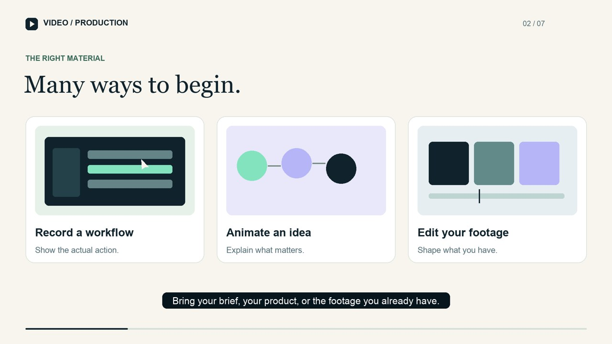

# Video Production

[](https://github.com/codebyutkarsh20/video-production-skill/actions/workflows/ci.yml)

An agent skill for turning briefs, interfaces and footage into reviewable videos. It covers planning, production, revision and repair, with clear output contracts and honest support levels.

**Version 0.1.0 — early release.** Use it with a skill-capable coding agent and the production tools available in your environment. Original code/instructions are MIT licensed; contributions are welcome.

## Quick install

With Node.js 22.20 or newer:

```sh
npx skills add codebyutkarsh20/video-production-skill --skill video-production
```

Select your agent when prompted. Add `--global` for user-wide installation. See [INSTALL.md](INSTALL.md) for Codex, Claude Code and Cursor examples, fixed-version installation, direct downloads, verification and updates.

**Ask your coding agent:**

> Install the video-production skill from https://github.com/codebyutkarsh20/video-production-skill/tree/main/skills/video-production for this project, check its available tools, then help me make a short preview from my source material.

For an agent-readable entry index, use [llms.txt](llms.txt). It points to the actual skill and conditional reference files; agents do not need to ingest the entire repository.

## See an example

[](https://github.com/codebyutkarsh20/video-production-skill/releases/download/v0.1.0/video-production-preview.mp4)

[Watch/download the 55-second showcase](https://github.com/codebyutkarsh20/video-production-skill/releases/download/v0.1.0/video-production-preview.mp4) · [Release downloads](https://github.com/codebyutkarsh20/video-production-skill/releases) · [Report a bug or suggest a feature](https://github.com/codebyutkarsh20/video-production-skill/issues/new/choose)

The showcase uses original graphics and local Piper narration. Source and reproduction steps are included. It demonstrates one production style; it is not a claim that all providers or video styles have been tested.

## What you can ask

- “Turn this document into a concise production brief.”
- “Record this product workflow and make a one-minute narrated preview.”
- “Create an animated explainer from these facts.”
- “Edit this footage into a captioned vertical clip.”
- “Fix the caption timing and the scene at 00:18.”
- “Diagnose this failed render without repeating paid jobs.”

The skill reuses information you supplied, checks actual tools and produces the artifact you requested. Brief-only stays brief-only. A requested preview ends at your review checkpoint. A directly authorized full build does not automatically acquire extra approval gates.

## Proactive creative help

The skill recommends a concrete creative direction, identifies missing assets and suggests relevant improvements to story, visuals and sound. It checks available tools first, then explains which optional connections or local tools could improve your result and what setup, cost or permissions they require.

Ask: “Help me choose a visual style and voice. Check what I already have, suggest the most useful additions, and start the work that is possible now.”

These are production instructions for the agent, not new bundled integrations. Voice auditions, image generation and specialist effects depend on tools actually available in your environment.

## Skill format and manual installation

Copy the `skills/video-production` directory into your agent's skills directory. For Codex, that is usually `~/.codex/skills/video-production`. For agents supporting the shared convention, use `~/.agents/skills/video-production`. Install in one location your agent discovers; avoid duplicate copies.

Invoke with `$video-production`, or let your agent select it for a relevant video request. The core follows the [Agent Skills format](https://agentskills.io/specification). Optional `agents/openai.yaml` supplies Codex-facing display metadata. Other hosts can use `SKILL.md` without it.

No API key, paid account or particular video provider is required to read/use the planning workflow. Media production needs an appropriate renderer/recorder and source assets. Capabilities vary by host.

## Support and limits

| Route | Maturity in this release | Availability on another machine |
|---|---|---|
| Briefs, scene plans, revisions and repair guidance | Independently exercised on selected agent scenarios | A skill-capable agent |
| Local clip composition, normalization and narration replacement | Actual FFmpeg integration tests | Python 3.10+, FFmpeg/ffprobe with libx264 and AAC |
| Animated motion graphics and local narration | Original 55-second rendered example | Example uses Pillow, FFmpeg, local fonts and optional Piper TTS/model |
| Actual screen recording | Fictional local browser workflow recorded and asserted | Browser automation/recorder; example uses Playwright Chromium |
| Generated scenes, avatars and hybrid video | Planning/adapter contract only; no bundled provider integration | Authorized external tool plus a tested adapter |
| Complex 3D, exact lip sync and long-form character continuity | Specialist/experimental guidance | Suitable tools and case-specific validation |

Local checks were run on macOS with Python 3.12. Cross-platform instructions describe prerequisites; they are not a claim of Linux/Windows acceptance. Availability and maturity are separate.

## Local helpers

The helper has no Python package dependencies. Run it from its actual installed path:

```sh
python3 skills/video-production/scripts/video_tools.py doctor
python3 skills/video-production/scripts/video_tools.py check /path/to/project.json
python3 skills/video-production/scripts/video_tools.py compose /path/to/project.json /path/to/output.mp4
python3 skills/video-production/scripts/video_tools.py verify /path/to/output.mp4 --manifest /path/to/project.json --report /path/to/report.json
```

See the [project contract](skills/video-production/references/project-contract.md) for the manifest. Inputs stay within the project directory. Chunks are cached by content/settings, verified before reuse and promoted only after successful validation. Existing outputs require explicit `--overwrite`.

This clip assembler fits/pads video, normalizes streams and can replace audio with a supplied narration file. Rich animation, music mixing, still-image scenes and burned-in captions belong in the agent's chosen composition tool. An audio stream can contain silence; metadata checks alone cannot certify sound quality.

## Reproduce the examples

Run from this repository root. Original examples use fictional records and original graphics. No private application is required.

```sh
python3 -m pip install -r requirements-examples.txt
python3 -m pip install -r requirements-tts.txt
python3 -m piper.download_voices en_US-ljspeech-high --download-dir artifacts/voices
python3 examples/showcase/render.py --stills-only
python3 examples/showcase/render.py
```

The showcase creates a 55-second 1080p/30fps preview, measured narration, SRT, source scene clips, stills and a contact sheet under `artifacts/showcase`. Its default narration is the local Piper `en_US-ljspeech-high` female US-English model. The separate download is about 114 MB; no paid inference is required. Use `--model` for another compatible model and recheck timing. The source archive does not bundle model weights or Piper binaries. Piper's engine is GPL-3.0; the model repository is labeled MIT and its model card identifies the training dataset as public domain. See the linked sources in the asset credits. The project's original code remains MIT.

Fonts are discovered from installed Arial/Georgia or DejaVu; no font binaries are bundled. `--voice` can explicitly select macOS system speech for a private preview; check its terms before any distribution. The supplied review preview uses Piper, not the restricted system voice.

The supplied captions follow separately synthesized and measured sentences, with explicit pauses between them. They require visual/listening review; this example does not claim word-level forced alignment.

For a real browser recording:

```sh
npm install --no-save playwright
npx playwright install chromium
node examples/browser-workflow/record.cjs
```

The example records its own fictional employee directory and asserts the saved result. It is not GMC/KYP footage or evidence of an external invitation/insurance operation. Follow `examples/browser-workflow/README.md` to convert and assemble the capture.

## Validation and contributing

```sh
python3 -m unittest discover -s tests -v
python3 scripts/package_release.py
```

FFmpeg integration tests require FFmpeg/ffprobe and libx264/AAC. If dependencies are unavailable, integration tests are explicitly skipped; do not count skipped tests as passing media verification.

See [release evidence](docs/release-evidence.md), [contribution guidance](CONTRIBUTING.md), [asset credits](ASSET-CREDITS.md) and [changes](CHANGELOG.md). Add a route, adapter, template or regression case with a reproducible example and truthful limits. The project is designed for broad video work across industries; it does not promise to solve every model limitation or every industry's business problem.

Good contribution areas: a tested generation-provider adapter, another licensed/local narration path, accessible video templates, cross-platform verification, caption alignment and targeted repair examples. Open an issue to discuss a substantial change, or fork the repository and submit a focused pull request. CI runs tests and builds both distribution archives for pull requests.

## License

Original code and instructions: [MIT](LICENSE). Third-party tools, installed fonts/voices and supplied media retain their own terms. No provider credentials or third-party model weights are included.
